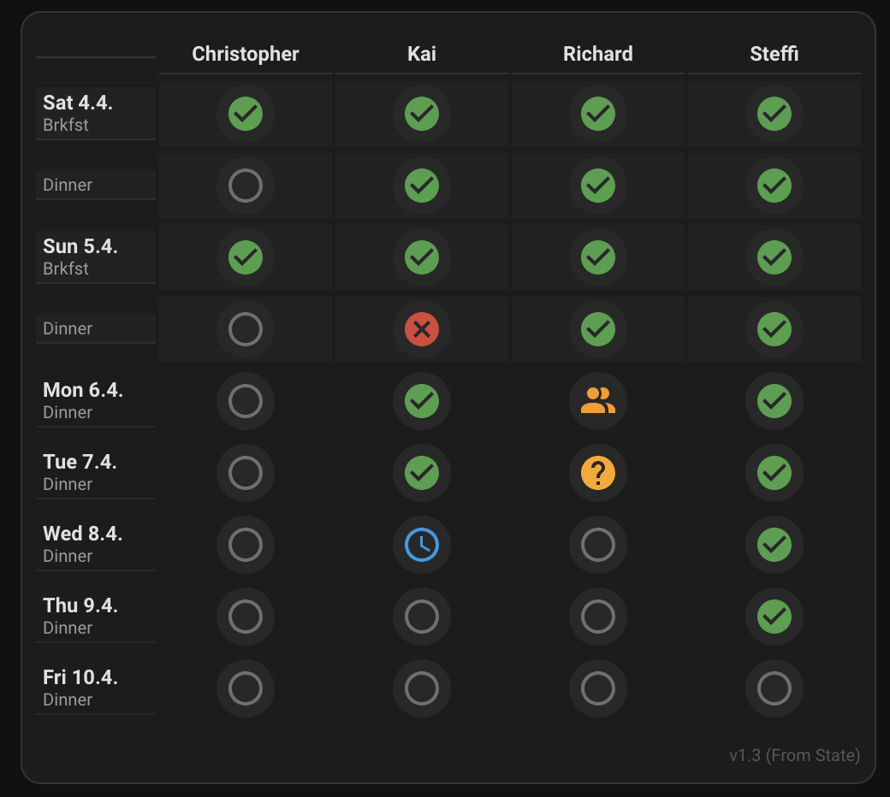

# Meal Attendance Card

[](https://hacs.xyz/docs/faq/custom_repositories/)
[](https://github.com/kgroshert/ha-meal-attendance-card/actions/workflows/validate.yml)

A Lovelace card for Home Assistant where everyone in the household marks whether they'll be home for meals over the next seven days.



- One column per `person` entity, one row per meal, starting today.
- Weekdays show **dinner**. Weekends show **breakfast** and **dinner**.
- Tap a cell to cycle through the answers. Votes are saved to `input_text` helpers, so they sync across all devices.
- Every vote fires a `meal_vote_changed` event that automations can use, for example to notify whoever is cooking.
- Can optionally restrict each user to their own column.

## Installation

### HACS (custom repository)

1. In Home Assistant, open **HACS**, click the menu in the top-right corner, and select **Custom repositories**.
2. Add `https://github.com/kgroshert/ha-meal-attendance-card` with the type **Dashboard**.
3. Search for **Meal Attendance Card**, install it, and reload your browser.

HACS registers the dashboard resource for you.

### Manual

1. Download `ha-meal-attendance-card.js` from the [latest release](https://github.com/kgroshert/ha-meal-attendance-card/releases/latest), or take it from the `dist` folder.
2. Copy it into `config/www/` on your Home Assistant.
3. Under **Settings → Dashboards → ⋮ → Resources**, add:
   - URL: `/local/ha-meal-attendance-card.js`
   - Type: **JavaScript module**
4. Reload your browser. When you update the file later, add or bump a query string such as `?v=2` on the resource URL so browsers fetch the new version.

## Setup

### 1. Create one helper per weekday

The card stores each day's votes as JSON in an `input_text` helper. Create seven of them, named `input_text.meals_monday` through `input_text.meals_sunday`.

Set **Maximum length to 255** (the default of 100 fills up quickly). You can do this in the UI under **Settings → Devices & services → Helpers → Create helper → Text**, or in YAML:

```yaml
input_text:
  meals_monday:
    name: Meals Monday
    max: 255
  meals_tuesday:
    name: Meals Tuesday
    max: 255
  meals_wednesday:
    name: Meals Wednesday
    max: 255
  meals_thursday:
    name: Meals Thursday
    max: 255
  meals_friday:
    name: Meals Friday
    max: 255
  meals_saturday:
    name: Meals Saturday
    max: 255
  meals_sunday:
    name: Meals Sunday
    max: 255
```

> The `day` field in the `meal_vote_changed` event is taken from the helper name (`input_text.meals_<day>`), so stick to this naming scheme if you use the event.

### 2. Make sure everyone is a `person`

The card shows every `person.*` entity, sorted by name, with the first name as the column header. To use `restrict_editing`, each person must be linked to a Home Assistant user (**Settings → People**).

### 3. Add the card

```yaml
type: custom:meal-attendance-card
restrict_editing: false
helpers:
  monday: input_text.meals_monday
  tuesday: input_text.meals_tuesday
  wednesday: input_text.meals_wednesday
  thursday: input_text.meals_thursday
  friday: input_text.meals_friday
  saturday: input_text.meals_saturday
  sunday: input_text.meals_sunday
```

## Options

| Name               | Type    | Default      | Description |
| ------------------ | ------- | ------------ | ----------- |
| `type`             | string  | **Required** | `custom:meal-attendance-card` |
| `helpers`          | object  | **Required** | Maps each weekday (`monday` … `sunday`) to its `input_text` helper. |
| `restrict_editing` | boolean | `false`      | When `true`, users can only change their own column. Other columns are dimmed. |
| `cycle`            | string  | see below    | The order in which a tap cycles through the vote codes, e.g. `ynm`. Applies to all meals. |

### Votes

| Code | Meaning              | Icon |
| ---- | -------------------- | ---- |
| `y`  | Yes                  | ✔ green |
| `p`  | Yes, plus a guest    | 👥 purple |
| `d`  | Yes, but late        | 🕒 blue |
| `n`  | No                   | ✖ red |
| `m`  | Maybe                | ? orange |
| —    | No answer yet        | ○ grey |

Each tap moves to the next code in the cycle. After the last one, the cell goes back to "no answer". The default cycle is `ypdnm` for dinner and `ypnm` for breakfast (no "late" option for breakfast).

## Automations

Every tap fires a `meal_vote_changed` event:

```yaml
event_type: meal_vote_changed
data:
  person: Kai Example   # friendly name of the person
  meal: dinner          # breakfast | dinner
  day: friday           # from the helper name
  from_vote: unknown    # previous code, or "unknown"
  vote: y               # new code, or "unknown" when cleared
```

Example that sends a notification when someone changes tonight's dinner vote:

```yaml
alias: Notify cook about dinner changes
triggers:
  - trigger: event
    event_type: meal_vote_changed
    event_data:
      meal: dinner
conditions:
  - condition: template
    value_template: "{{ trigger.event.data.day == now().strftime('%A') | lower }}"
actions:
  - action: notify.mobile_app_your_phone
    data:
      message: >
        {{ trigger.event.data.person }} changed tonight's dinner from
        {{ trigger.event.data.from_vote }} to {{ trigger.event.data.vote }}.
mode: queued
```

Rapid taps fire one event per tap. Use `mode: queued` or a short delay if you only care about the final answer.

## Data format

Each helper holds a small JSON object keyed by meal, then by the person's object ID:

```json
{"dinner": {"kai": "y", "alex": "d"}, "breakfast": {"kai": "n"}}
```

You can reset a day by setting its helper to an empty value, for example with a weekly automation.

## License

[MIT](LICENSE)
